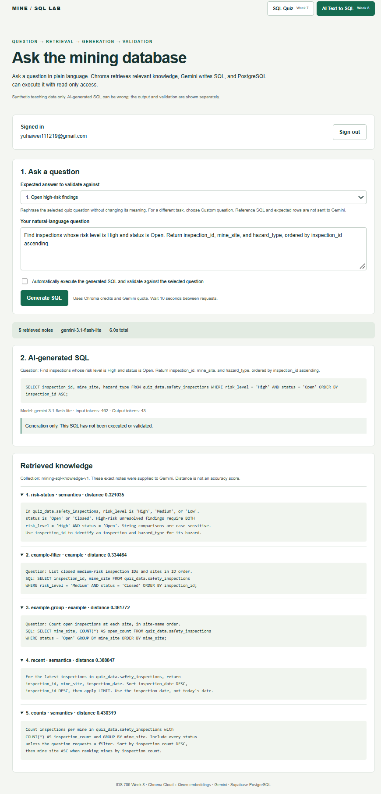
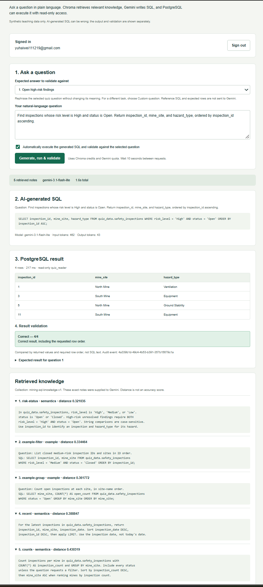

# Mining Safety SQL Quiz and RAG Text-to-SQL

[](https://github.com/USERZEROA/sql-quiz-supabase/actions/workflows/ci.yml)

**Week 8 — RAG Text-to-SQL:** [Ask the mining database](https://sql-quiz-supabase.vercel.app/rag)  
**Week 7 — SQL Quiz:** [Open the original quiz](https://sql-quiz-supabase.vercel.app)

## Grading access: check Canvas assignment comments

**The quiz login email and password will be provided in the Canvas assignment comments for each week. Please check the comments before signing in. The same quiz account works on both pages.**

This IDS 706 project combines the Week 7 SQL quiz with the Week 8 RAG extension. Both pages use Next.js, Supabase Auth, and the same hosted PostgreSQL database. The dataset contains 12 synthetic safety-inspection records from three mine sites, not real inspections or safety advice. Use the navigation buttons to switch between the two pages.

## Week 8: RAG Text-to-SQL

### How the RAG pipeline works

```text
Natural-language question
  → Qwen question embedding
  → Chroma vector retrieval
  → Retrieved notes + question sent to Gemini
  → Generated SQL displayed
  → Optional automatic read-only execution
  → Result table and validation
```

Chroma Cloud stores eight knowledge records in `mining-sql-knowledge-v1`: the table schema, business rules, and two example question/SQL pairs. The notes are defined in `lib/rag-knowledge.ts`. Indexing and retrieval use Chroma Cloud's `Qwen/Qwen3-Embedding-0.6B` model with the `nl_to_code` task. A question triggers actual vector retrieval for the five closest notes; the website displays their IDs, contents, and distances. These distances are not accuracy scores.

The server sends those retrieved notes and the question to the Gemini `generateContent` API. The default model is `gemini-3.1-flash-lite`. The selected quiz question's reference SQL and expected rows are not added to the prompt; they are kept for result validation. The retrieved collection includes the separate few-shot examples described above. Retrieval and generation failures are displayed instead of being replaced with reference answers.

### Using the RAG page

Sign in at `/rag`, select the quiz question to validate against, and enter or rephrase its natural-language question. Keep **Automatically execute the generated SQL and validate against the selected question** checked, then click **Generate, run & validate**. One request retrieves knowledge, generates SQL, executes it through the existing read-only query service, and compares the returned values and required ordering with the selected answer. No manual copying of SQL is needed.

Clear the checkbox to use **Generate SQL** without executing it. For a question outside the five quiz tasks, select **Custom question**: the application can generate and execute SQL, but reports that no reference answer is available rather than grading it against an unrelated quiz question. Changing a preset question's meaning without changing the selection still validates against that selected task.

Generated SQL, execution results, and validation are shown separately. SQL that fails the safety checks remains visible with an execution error. AI-generated queries use the same AST validation, `quiz_reader` account, read-only transaction, timeout, and row limit as handwritten queries.

Allow at least ten seconds between requests and wait for the current request to finish. Calls consume Gemini quota and Chroma usage. The per-user guard is local to a server instance, not a global spending cap. The RAG page does not save a separate conversation or update the original quiz's in-memory total. Audited SQL execution can be reviewed through **My activity** on the Week 7 page; generation-only requests are not SQL audit events. Save a Week 7 draft before navigating away if you need to keep it.

### RAG demonstration

**Question and generated SQL.** In generation-only mode, the application displays the question, Gemini's SQL, and the retrieved knowledge without executing the query.



**Automatic execution and validation.** With execution enabled, the generated query returns inspections 1, 3, 5, and 11. The result table and **Correct — 4/4** validation appear below the SQL.



## Week 7: Taking the SQL quiz

The original page at `/` remains available. Its five questions are worth four points each. Sign in, choose a question, enter SQL, and click **Run SQL & check answer**. The result comes from PostgreSQL. Each question includes a hint, reference SQL, and an expected result table. Grading compares the returned values and the requested column and row order, not SQL text or column aliases. A correct answer earns 4 points; an incorrect answer earns 0. The total is displayed out of 20. Hints are available throughout the practice quiz.

Editing an answer or its parameters clears that question's displayed score until it is run again. **Preview live data** retrieves all 12 records without awarding points. **Save quiz** stores a private copy of the questions, answers, parameters, and scores derived from recorded runs. Refresh and click **Open** to restore it. **New copy** starts another draft.

Signed-out visitors may read hints and edit an unsaved draft, but cannot execute queries, preview live data, save, or retrieve private records. RAG generation also requires sign-in. The website offers sign-in and sign-out only; it does not offer public registration or send registration emails.

### Parameterized queries

All five questions on the SQL quiz page accept an optional JSON parameter array. Use `[]` when no parameters are needed. The first question has a **Use parameterized example** shortcut:

```sql
SELECT inspection_id, mine_site, hazard_type
FROM quiz_data.safety_inspections
WHERE risk_level = $1 AND status = $2
ORDER BY inspection_id;
```

```json
["High", "Open"]
```

Values are passed separately through node-postgres's `values` argument, not inserted into SQL text. The validator checks placeholder numbering and parameter types. The live database test also verifies that injection-like parameter text remains data. Other questions can use parameters where appropriate, such as `LIMIT $1` with `[3]` in question 3. The RAG generator currently produces self-contained SQL with literal values rather than asking users to fill parameter placeholders.

## Local setup

Use Node.js 22 or 24. Copy `.env.example` to `.env.local` in the repository root and fill in the values below. Keep an existing configured `.env.local` if you already have one. The combined application uses eight variables:

| Variable | Purpose |
| --- | --- |
| `NEXT_PUBLIC_SUPABASE_URL` | Supabase HTTPS Project URL. |
| `NEXT_PUBLIC_SUPABASE_PUBLISHABLE_KEY` | Publishable key for the client and authenticated requests. |
| `QUIZ_DATABASE_URL` | `quiz_reader` Session pooler URI, port 5432, with `?sslmode=require`. Server only. |
| `QUIZ_DATABASE_CA_CERT` | Trusted CA PEM text, including BEGIN and END lines. Server only. |
| `GEMINI_API_KEY` | Gemini API key used by the RAG backend. Server only. |
| `CHROMA_API_KEY` | Chroma Cloud key for embeddings and vector database access. Server only. |
| `CHROMA_TENANT` | Tenant ID from the Chroma connection settings. |
| `CHROMA_DATABASE` | Chroma database name, `mining-sql-rag` for this project. |

`GEMINI_MODEL` is optional and defaults to `gemini-3.1-flash-lite`. The PostgreSQL password belongs to `quiz_reader`, not a website user. Use the Session pooler username `quiz_reader.<project-ref>` and percent-encode reserved password characters in the URI. TLS certificate verification stays enabled. The CA accepts actual line breaks or escaped `\n` sequences. Keep `.env.local` excluded from Git, and do not prefix provider keys with `NEXT_PUBLIC_`.

```powershell
npm ci
npm run dev
```

Open `http://localhost:3000` for the original quiz or `http://localhost:3000/rag` for the RAG page. Dependencies and their versions are recorded in `package.json` and `package-lock.json`.

The development and build scripts use Webpack for compatibility with the Chroma packages. To test a production build locally:

```powershell
npm run build
npm run start
```

## Database and authentication

For a new Supabase project, run these files in order in the SQL Editor as `postgres`:

```text
supabase/01_quiz_data.sql
supabase/02_quiz_reader_permissions.sql
supabase/03_saved_quizzes.sql
supabase/04_extra_credit.sql
```

Assign `quiz_reader` its LOGIN setting and password separately. The scripts contain no passwords. Keep `quiz_data` outside the Data API's exposed schemas: teaching queries use the authenticated Next.js endpoint and Session pooler, while saved quizzes use the user's Supabase token and owner-only row-level security (RLS). The existing project already has these migrations applied. The Week 8 extension requires no additional PostgreSQL migration.

Keep the Email provider enabled in Supabase Auth and disable **Allow new users to sign up**. Create and auto-confirm grading accounts through **Authentication → Users → Add user → Create new user**. Set the Auth Site URL to `https://sql-quiz-supabase.vercel.app`. No OAuth application, SMTP service, or database administrator credential is required by the website.

## Building the vector knowledge base

For a fresh Chroma database, or an intentional update to the notes, run:

```powershell
npx tsx scripts/index-rag.ts
```

The script checks the live PostgreSQL columns, types, and nullability against the teaching schema, then embeds and upserts the eight stable knowledge IDs. It creates the collection if needed and checks its embedding metadata. Indexing consumes Chroma embedding usage; it does not call Gemini or change PostgreSQL data.

The deployed project already has these eight records indexed. Indexing is needed only for a new collection or changes to the notes. Website requests retrieve from the existing collection; they do not seed it. Both Chroma Cloud and Gemini must be reachable from the deployed backend.

## Audit history and integrity

**My activity** on the Week 7 page shows the caller's latest 50 recorded query and save events, including the user ID, server timestamp, operation, and SQL/parameters or saved contents. Save, update, and delete events are recorded by a database trigger in the same transaction as the saved record.

The private `quiz_audit.events` table denies direct access to `anon`, `authenticated`, and `quiz_reader`. After verifying a user, the backend can call a narrowly granted append function, but student SQL cannot call it. A read-only RPC returns only the caller's history. Saved scores are derived from matching server-recorded runs; client-supplied scores are ignored. These controls protect against the taker roles, not the database owner, and do not promise a complete access log during outages.

Run `supabase/05_verify_audit_integrity.sql` as `postgres` for the administrative integrity check. It exercises denied operations, caller isolation, unchanged entries, save logging, and forged-score rejection. Temporary data and role grants are rolled back; existing records and permissions remain unchanged after a successful run.

## Checks, CI, and deployment

```powershell
npm run check:all
```

This runs TypeScript checking, automated tests, the production build, `check:db`, and `check:audit`, stopping on failure. The database check executes all five reference answers and parameterized queries against Supabase. The audit check verifies privileges and actually attempts prohibited operations as `quiz_reader`. SQL script 05 separately checks the other taker roles and database triggers.

The RAG tests cover input validation, retrieved context passed to Gemini, generated SQL passed to execution, generation-only mode, custom questions, API failures, and result validation. These tests use mocked providers. Live retrieval and generation are tested separately through `/rag`.

GitHub Actions uses Node.js 22. The `tests` job runs offline checks and a build; `live-database` runs `check:db` and `check:audit` using the repository Secrets `QUIZ_DATABASE_URL` and `QUIZ_DATABASE_CA_CERT`. Pushes to `main` and manual runs include the live checks. Pull requests run offline checks without those secrets. RAG tests are included in the normal test suite, but CI does not make generation calls on every push. The badge links to the current workflow results.

To deploy, import this repository into Vercel as Next.js and configure all eight variables for Production. Keep the repository root as the project root and use the project's `build` script. Environment-variable changes require a new deployment. An existing Week 7 deployment needs the four additional RAG variables, but no new PostgreSQL migration.

Both public pages should be accessible without a Vercel account. The application itself requires a quiz account to run queries or generate SQL.

## Verification and limitations

The Week 7 baseline passed **117 automated tests**, the production build, and both live database checks. SQL script 05 completed **19 integrity checks**. Week 7 production acceptance covered all five answers, **20/20** scoring, incorrect-answer scoring, save/reopen recovery, query and save activity, cross-account isolation, and signed-out restrictions. That record is retained in [docs/acceptance.md](docs/acceptance.md).

With the RAG extension, the combined suite has passed **145 tests**, and the production build completed after switching to Webpack. The recorded RAG browser demonstrations show actual five-note retrieval, Gemini SQL generation, generation-only behavior, and automatic execution of the first question with four matching rows and a **Correct — 4/4** result. The screenshots above show these recorded runs.

Both pages use a limited SQL subset: one SELECT over the teaching table, common expressions and aggregates, grouping, sorting, and LIMIT. Joins, CTEs, subqueries, other schemas, and writes are not supported. Execution is read-only, has a three-second statement timeout, and displays at most 100 rows. Model output is subject to the same checks as handwritten SQL. Provider quotas, API availability, and retrieval quality can affect generation, and failures are shown rather than replaced with preset answers.
